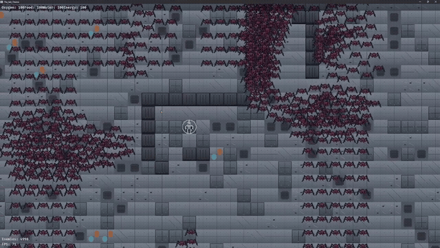

# The Last Vestige

A top-down colony builder/defender, in the style of RimWorld, built solo in Rust on the [Bevy](https://bevyengine.org/) game engine.

The last survivors of your chosen species crash-land on a derelict mass of scavenged, fused-together ships — untold threats already living inside. You rebuild what defences you can, tile by tile, while a horde numbering in the thousands closes in from every side.

There is no win condition. There is no survival ending. The entire design premise is that you *will* lose eventually — the only question the game is asking is how long you can hold.

*Design goal, not yet built:* enemies currently swarm toward whichever colonist is nearest (see [Pathfinding](#pathfinding-a-and-flow-fields-implemented-from-scratch) below); the intent is for the AI to eventually evaluate the player's defences and route around strongpoints toward weaker ones. Worth being upfront about that distinction if this comes up in an interview.



---

## Why this project

This was my first Rust project beyond "hello world" — I came in knowing nothing about the language and picked it up as I went, learning structs, enums, `impl` blocks, and ECS concepts directly through building this rather than through a separate tutorial track. About halfway through, I took a detour to build a simple controller in Rust on a Raspberry Pi Pico, which confirmed the fundamentals had actually transferred rather than being tied to this one codebase.

I'm interested in game development and wanted to look past the "big three" engines before committing to one. That's how I found Bevy, and specifically its ECS architecture — after learning what ECS actually was, I realized I preferred it over the OOP patterns I'd been exposed to elsewhere. I like RimWorld and wanted to build something in that vein, but the real motivation was pushing on how far ECS could be taken as an architecture — how much of a real-time simulation with hundreds of independent, interacting agents could be expressed as composable data and systems rather than an object hierarchy, and where that model actually starts to strain.

---

## Technical highlights

### Pathfinding: A* and Flow Fields, implemented from scratch

Two complementary pathfinding systems, chosen for what each is actually good at rather than picking one algorithm for everything:

- **A\*** (`ai/a_star.rs`) drives player-directed colonist movement — 8-directional, non-uniform movement cost (cardinal = 10, diagonal = 14, approximating √2×10) with a Chebyshev heuristic scaled to match and stay admissible. Includes no-corner-cutting (a diagonal move is rejected if either bordering cardinal tile is a wall) and lazy deletion in the open set to avoid the overhead of a decrease-key operation.
- **Flow fields** (`ai/flow_fields.rs`) drive enemy swarm movement — a single Dijkstra expansion computes a direction-to-nearest-goal for *every* reachable tile at once, so N enemies converging on colonist positions cost one shared O(map) computation instead of N independent path searches. Multiple simultaneous goals fall out for free by seeding them all into the priority queue at cost 0 before the search starts.

### Data-oriented architecture (Bevy ECS)

The whole simulation — colonists, enemies, tiles, combat, UI — is built as composable components and systems rather than an inheritance hierarchy or a handful of monolithic "God objects." A few decisions worth pointing at specifically:

- **Generic death handling** — a single `tag_dead` system detects `Health::is_dead()` across *any* entity type and inserts a `Dead` marker; type-specific reactions (`dead_enemies_handler`, `dead_colonists_handler`) subscribe to that marker independently. Adding a new entity type that can die requires zero changes to the tagging logic.
- **Event-driven tile updates** — mutating the map fires one `TileChangedEvent`; visual re-texturing and pathfinding invalidation are two independent listeners on that event, with no direct coupling between "a wall broke" and "the tilemap texture updated."
- **Encapsulated invariants, not conventions** — `Health` keeps `current`/`max` private and exposes only `change_health()`/`is_dead()`, so "health can't exceed max" and "health can't go negative" are enforced once, structurally, rather than trusted at every call site.
- **Cross-plugin system ordering without tight coupling** — plugins order against each other's systems via explicit `.after()`/`.before()` on imported function names (e.g. death ordering after both combat systems, animation state-decisions ordering before frame-advance), rather than merging unrelated plugins together or reaching into each other's internals.

### Performance at scale

The enemy separation system (`separate_enemies`) is a pairwise repulsion check between every enemy and every other enemy — an O(N²) algorithm. Measuring it directly rather than assuming it's fine: on dev hardware, **5,000 simultaneously active enemies hold ~80fps**; pushing to 8,000 drops well below 30fps and becomes visibly stuttery. That ceiling is the pairwise scan, not the renderer or any other system.

The fix isn't implemented yet — it's a spatial hash or grid-based neighbour lookup, so separation only checks nearby enemies instead of the entire population. That's a known, scoped next step, not a mystery bottleneck; the measurement above is what motivates prioritizing it.

Horde footage is at the top of this README (`README_Assets/overview.gif`).

### Real-time sprite animation system

A shared, entity-type-agnostic frame-advance system serves colonists today and is already generic enough to serve enemies once they need it — no code duplication required to add a second consumer:

- One playback component (`AnimationPlayback`: current sheet handle, atlas layout, frame index, timer) is written to by small per-entity-type "decide what should be playing" systems, and read by a single system that advances frames and syncs the sprite each tick.
- State priority arbitration (attack > walk > idle) is computed from existing gameplay state — pathing queue and live enemy-range checks — rather than an explicit state machine needing manual transition wiring.
- Per-state frame timing is independently tunable (attack plays slower than the idle/walk cycle) without touching the frame-advance logic itself.

### Combat, selection, and building systems

- RTS-style unit selection: click-to-select-nearest and drag-box multi-select, both replacing rather than additively stacking selection (implemented via a lightweight `DragSelection` resource and a pixel-distance threshold to disambiguate a click from the start of a drag).
- Destructible/buildable tiles with passability that's *always* derived from tile type (`is_passable()`) rather than tracked as a separate, potentially-desynced field.
- Attacker/Target components support both autonomous "nearest enemy in range" combat and player-directed "attack this specific target" spot orders, with automatic fallback to autonomous mode if a spotted target despawns mid-fight.

---

## What's next

In priority order:

1. **Procedural map generation** — replace the current random-floor-variant-only generation with proper procedural layout (BSP rooms or cellular automata), hooked into a future chunk system so new areas generate as they're revealed.
2. **Binary save/load** — serialize world state (map, colonist/enemy positions and health, buildings) via `bincode` + `serde`, so a session can persist rather than resetting on every run.
3. **Fix the O(N²) separation bottleneck** — see [Performance at scale](#performance-at-scale) above; replace the pairwise enemy-separation scan with a spatial hash or grid-based neighbour lookup so the horde count isn't capped by an easily-avoidable algorithmic cost.

Lower priority, but still planned: the remaining colonist animation states (carry/work/sleep) and enemy animation from scratch (currently a static sprite with no sheet, states, or playback component).

---

## Running it

```bash
cargo run          # build and run (desktop only)
cargo test         # run tests
```

No special setup beyond a working Rust toolchain — `cargo run` is all that's needed. The first build will be slow (Bevy's dependency tree is large); subsequent builds are fast.